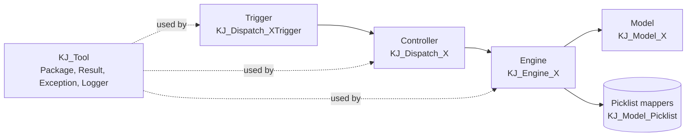
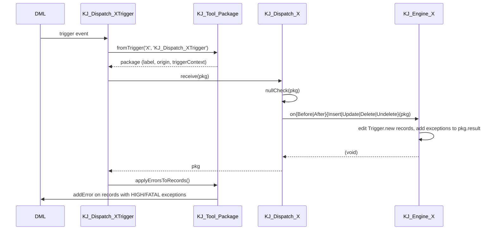
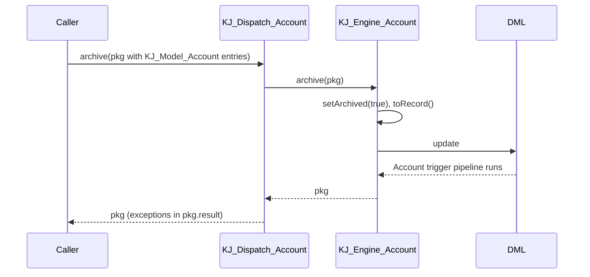

# Architecture
Owner: Slate Thompson
Status: stable
Last verified: 2026-10-30
Verified against: kjhc-v2-sf@master ad92d8b

The KJ_ framework: its domains, its layers, and how a package moves through them.

## Domains
Each domain is an SFDX package directory (`sfdx-project.json`). Class names start with the domain name.

| Domain | Holds | Built |
|---|---|---|
| `KJ_Tool` | Package, data, context, result/exception, logging, formatting, test data factory | Yes |
| `KJ_Model` | Object metadata (`objects/`), model classes, `KJ_Model_Picklist` | Account and Contact models only |
| `KJ_Dispatch` | One trigger and one controller per object | All 7 objects |
| `KJ_Engine` | One engine per object (`classes/<object>/`) | All 7 objects |
| `KJ_Integrate` | Inbound and outbound integration | No. Only `.gitkeep`. |
| `KJ_UI` | UI metadata | No. Only `.gitkeep`. |
| `KJ_Execute` | Anonymous Apex scripts (`scripts/apex/`), not deployed as metadata | Scripts only |

The 7 objects are Account, Contact, `Customer_Property__c`, `Membership__c`, `HVAC_Unit__c`, `Project__c` and `Job__c`.

## Layers

| Layer | Does | Doesn't |
|---|---|---|
| Trigger | Builds the package with `KJ_Tool_Package.fromTrigger(objectName, triggerName)`, calls `KJ_Dispatch_X.receive`, then `applyErrorsToRecords()` on the returned package | Hold logic |
| Controller (`KJ_Dispatch_X`) | Null-checks the package and routes it to the engine method for the trigger event. Turns any thrown exception into a FATAL `KJ_Tool_Exception`. | Touch records |
| Engine (`KJ_Engine_X`) | Defaults, validation, and updates to related records. One static method per trigger event, plus called operations. | Throw for validation. It adds exceptions to the package instead. |
| Model (`KJ_Model_X`) | Typed wrapper for one record: `build()` from a record, `toRecord()` back, `setX()` setters, field groups, `getFields()` | Query. Callers build their own SOQL from `getFields()`. Query and retrieval code is planned (stated by Slate). |

There is no separate process layer.

## Object operation pipeline (trigger)
All 7 objects use this path. Each trigger fires on all 7 events (before/after insert, update and delete, and after undelete).

Source: `KJ_Dispatch/main/default/triggers/`, `KJ_Dispatch/main/default/classes/controllers/`, `KJ_Tool/main/default/classes/package/KJ_Tool_Package.cls`.

- `fromTrigger` lives on the package "so every trigger body stays a one-liner and the controller never has to reach into static Trigger state itself" (code comment, `KJ_Tool_Package.cls`).
- `route()` adds a FATAL `INVALID_CONTEXT` exception if `pkg.triggerContext` is null.

## Called operation pipeline
This is an operation that Apex calls directly, not a trigger. The only one built so far is Account `archive`.

- The caller wraps each model in a `KJ_Tool_DataEntry` inside the package's `KJ_Tool_DataBundle`.
- An exception thrown in the engine becomes a FATAL `OPERATION_ERROR` in the controller.
- Example caller: `KJ_Execute/scripts/apex/tests/accountPkgPipelineTest.apex`.

## Integration pipeline
Not built yet (stated by Slate). `KJ_Integrate` holds no metadata.

## Package
`KJ_Tool_Package` (`KJ_Tool/main/default/classes/package/`):

| Member | Type | Set by |
|---|---|---|
| `label` | String | `withLabel`. Triggers use `'<Object> Trigger Package'`. |
| `dataBundle` | `KJ_Tool_DataBundle` (list of `KJ_Tool_DataEntry`: label, dataType, value) | `build(bundle)` |
| `result` | `KJ_Tool_Result` | Constructor. Engines add exceptions to it. |
| `origin` | `KJ_Tool_Origin` (APEX, RECORD, INTEGRATION, UNSPECIFIED) | `withOrigin`. Triggers use `fromApex`. |
| `triggerContext` | `KJ_Tool_TriggerContext` (copy of `Trigger.*`) | `fromTrigger` |
| `orgContext`, `userContext` | `KJ_Tool_OrgContext`, `KJ_Tool_UserContext` | `withOrgContext` / `withUserContext`. Not set by any current caller. |

## Errors
`KJ_Tool_Exception` (`KJ_Tool/main/default/classes/package/result/KJ_Tool_Exception.cls`):

| Level | Effect in a trigger (`applyErrorsToRecords`) | Effect on `KJ_Tool_Result` |
|---|---|---|
| LOW | None | `hasLows = true`. `isSuccess` is unchanged. |
| HIGH | `addError` on `e.record`, or on every record in the batch when `record` is null | `isSuccess = false`, `hasHighs = true` |
| FATAL | Same as HIGH | `isSuccess = false`, `hasFatals = true` |

| Code | Used for |
|---|---|
| `ROUTING_ERROR` | The controller's `route()` threw |
| `INVALID_CONTEXT` | Null package, or no trigger context |
| `MISSING_DATA` | The data bundle lacks what the engine needs (`archive` with no entries) |
| `OPERATION_ERROR` | An engine operation threw (e.g. failed DML) |
| `VALIDATION_ERROR` | Engine validation failed. Always HIGH, with the record attached. |
| `DEFAULT_CODE`, `TEST_EXCEPTION` | Fallback, and tests |

On delete, `applyErrorsToRecords` targets `oldList`. Otherwise it targets `newList`.

## Engine patterns
The same shape is used in every `KJ_Engine_X.onBeforeInsert`:
1. Gather parent Ids from `ctx.newList` into `Set<Id>`s.
2. Run one query per parent object into a `Map<Id, SObject>`.
3. Loop over the records:
   - Validate. On failure, add a HIGH `VALIDATION_ERROR` with the record, then `continue`.
   - Fill blank fields from parents.
4. Read parent fields with `?.`, because a parent is null when the lookup is blank.
5. Updates to related records are collected in a `Map<Id, SObject>` and updated once (commit `877457f`). Example: `KJ_Engine_Job.markLastServiceDate`.
6. Compound address fields are null in before triggers, so engines read and write the component fields (`Service_Address__Street__s`, etc.).

## Models
`KJ_Model_Account`, `KJ_Model_Contact` (`KJ_Model/main/default/classes/`):
- **Field groups** are `List<SObjectField>` constants (`VITAL_DATA`, `NOTES_DATA`, `CONTACT_DATA`, `LOCATION_DATA`, `METADATA_DATA`, ...). `getFields()` returns all of them.
- **`build(record)`** reads `getPopulatedFieldsAsMap()`, so fields that weren't queried keep their defaults.
- **`toRecord()`** writes only non-null members (`put` skips nulls).
- **Picklist fields** are held as `KJ_Model_Picklist` enums, converted with `mapTo<Type>(String)` and `mapToString(enum)`.
- **Defaults:** scalars default to null, Booleans to `false`, and picklist enums to `UNKNOWN`.

## Logging
`KJ_Tool_Logger` (`KJ_Tool/main/default/classes/logging/`) builds a `KJ_Tool_LogEntry`, formats it with `KJ_Tool_Formatter.toString`, and writes it to `System.debug` at the mapped `LoggingLevel`. Nothing is persisted.

## Gaps
- `TODO(slate): Should Account onBeforeDelete add exceptions to the package like the other engines, instead of calling addError directly?` (`KJ_Engine_Account.cls`)
- Engine validations run before insert only. Updates aren't validated.
- `KJ_Tool_Origin.SourceType.INTEGRATION` has no factory method.
